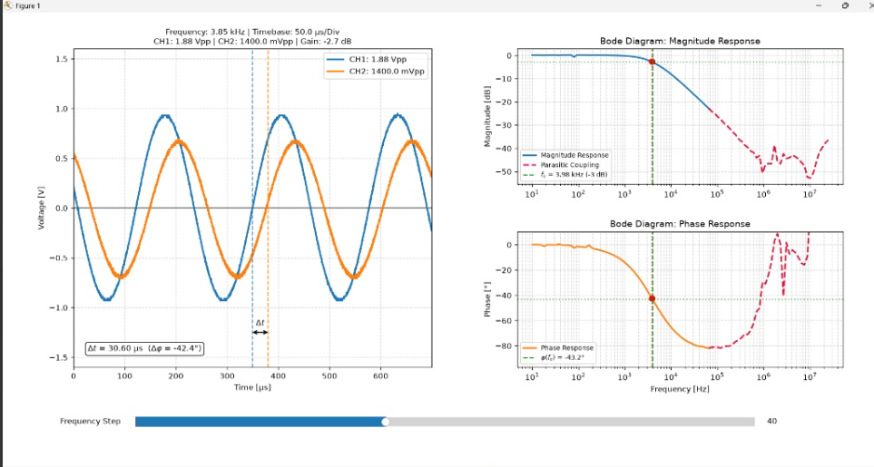

# Automated Bode Plotter & FRA for Hantek DSO2D10

[](https://www.python.org/downloads/)
[](https://opensource.org/licenses/MIT)
[](#hardware-setup)

An automated Frequency Response Analyzer (FRA) that turns a budget **Hantek DSO2D10** oscilloscope and its integrated DDS function generator into a full-featured Bode plotting testbench via USB/SCPI.



---

## ⚡ Key Engineering Features

* **High-Speed SCPI Automation:** Sweeps 100 logarithmic frequency steps (10 Hz – 25 MHz) by controlling the integrated DDS generator and adaptive oscilloscope timebases via `PyVISA-py`.
* **Coherent Hann-Windowed Single-Bin DFT:** Projects captured time-domain buffers onto continuous orthogonal carriers to extract precise magnitude and phase while completely eliminating spectral leakage without filter-type assumptions.
* **Automated Cutoff Detection:** Accurately determines the $-3\,\text{dB}$ cutoff frequency ($f_c$) and passband phase angle using sub-bin logarithmic interpolation[cite: 7].
* **Bidirectional Parasitic Crosstalk & Noise Classification:** Automatically identifies the filter topology (low-pass vs. high-pass) and classifies where circuit board parasitic coupling and ADC noise floor dominate, seamlessly transitioning the plot into a synchronized dashed red trajectory.
* **True Zero-Crossing Phase Dimensioning:** Live $\Delta t$ phase dimensioning using sub-sample linear interpolation to dynamically measure both phase lag ($\Delta\varphi < 0^\circ$) and phase lead ($\Delta\varphi > 0^\circ$) near the window center without baseline clutter.
* **Interactive Inspection Dashboard:** Real-time synchronized time-domain oscilloscope traces and frequency-domain Bode plots driven by an embedded Matplotlib slider[cite: 7].

---

## 📌 Validation Status & Roadmap

| Feature / Filter Type | Status | Notes |
| :--- | :---: | :--- |
| **Passive 1st & 2nd Order Low-Pass / High-Pass** | ✅ Validated | Tested 10 Hz – 25 MHz; bidirectional SNR cutoff & phase tracking verified |
| **Automated -3 dB Cutoff Detection** | ✅ Validated | Sub-bin logarithmic interpolation verified[cite: 7] |
| **Parasitic Crosstalk Handling** | ✅ Validated | Synchronized trajectory cutoff at SNR limit (~ -36 dB / 18 mV) |
| **Active Filters (Sallen-Key, MFB)** | ⏳ In Progress | Validation for circuits with passband gain ($> 0\text{ dB}$)[cite: 7] |
| **Bandpass & Notch Topologies** | 📋 Planned | Auto-ranging baseline detection under evaluation |

---

## 🛠️ Hardware Setup

Connect your Device Under Test (DUT) using standard 1X/10X probes[cite: 7]:

1. **CH1 (Input / Reference):** Connect to the **DDS Wave Out** terminal of the oscilloscope[cite: 7].
2. **CH2 (Output / DUT):** Connect to the filter output[cite: 7].
3. Connect the oscilloscope to your PC via the rear USB-B port[cite: 7].

---

## 🚀 Quickstart

### 1. Clone & Install Dependencies
```bash
git clone [https://github.com/jschober2004-cpu/hantek-dso2d10-bode-analyzer.git](https://github.com/jschober2004-cpu/hantek-dso2d10-bode-analyzer.git)
cd hantek-dso2d10-bode-analyzer
pip install -r requirements.txt
```

### 2. Configure Instrument VISA Address
Check your device address via `pyvisa-info` and update `VISA_RESOURCE_ID` in `hantek_bode_analyzer.py`:
```python
VISA_RESOURCE_ID = "USB0::1183::20574::CN5606029103430::0::INSTR"
```

### 3. Run Sweep
```bash
python hantek_bode_analyzer.py
```

---

## 🔬 Mathematical Background (DFT Extraction)

Rather than noisy peak-to-peak voltage estimation, the transfer function $H(j\omega) = \frac{U_2(j\omega)}{U_1(j\omega)}$ is computed via discrete projection using a Hann window $w[n]$:

$$U_k(f) = \frac{2}{\sum w[n]} \sum_{n=0}^{N-1} u_k[n] \cdot w[n] \cdot e^{-j 2 \pi f n \Delta t}$$

$$\text{Gain [dB]} = 20 \log_{10} \left( \frac{\vert{}U_2(f)\vert{}}{\vert{}U_1(f)\vert{}} \right), \quad \Delta \varphi = \arg(U_2) - \arg(U_1)$$

---

## 📄 License
Distributed under the MIT License. See `LICENSE` for more information.
