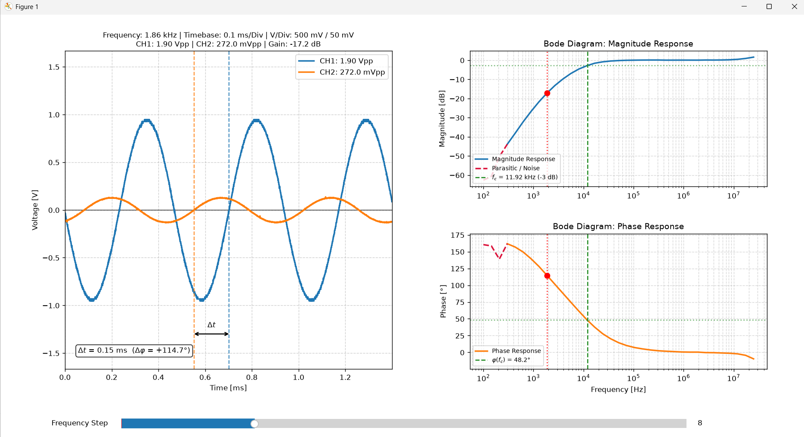

# Automated Bode Plotter & FRA for Hantek DSO2D10

[](https://www.python.org/downloads/)
[](https://opensource.org/licenses/MIT)
[](#hardware-setup)

An automated Frequency Response Analyzer (FRA) that turns a budget **Hantek DSO2D10** oscilloscope and its integrated DDS function generator into a full-featured Bode plotting testbench via USB/SCPI.



---

## ⚡ Key Engineering Features

* **High-Speed SCPI Automation:** Sweeps logarithmic frequency steps (default: 100 points, 10 Hz – 25 MHz) by controlling the integrated DDS generator and adaptive oscilloscope timebases via `PyVISA-py`.
* **Configurable Sweep:** A start dialog sets the number of points, frequency range and stimulus amplitude, and shows an estimated sweep duration.
* **Auto-V/div (Auto-Ranging, default on):** CH1 is set once to the finest 1-2-5 step where the stimulus spans at most ~6 divisions (verified by a test acquisition). CH2 is re-ranged at every point: starting from the previous point's V/div, it switches one step coarser when the signal clips or exceeds ~7 div, and one step finer below ~2.4 div (max. 4 switches per point, with hysteresis). This keeps the 8-bit ADC well utilised deep into the stopband. The scope's original V/div settings are restored after the sweep.
* **Manual Vertical Scale:** With Auto-V/div off, the V/div of CH1/CH2 is read from the instrument (probe attenuation included) and left unchanged. In both modes, points where the signal hits the ADC limits are flagged as clipped.
* **Coherent Hann-Windowed Single-Bin DFT:** Projects captured time-domain buffers onto continuous orthogonal carriers to extract precise magnitude and phase with strongly suppressed spectral leakage and without filter-type assumptions.
* **Automated Cutoff Detection:** Accurately determines the $-3\,\text{dB}$ cutoff frequency ($f_c$) and passband phase angle using sub-bin logarithmic interpolation.
* **Trend-Based Parasitic Detection (both sides):** Starting in the passband (the highest *flat* region, so a parasitic rise at the band edge is not mistaken for it), the response is followed towards lower *and* higher frequencies, so low-pass, high-pass and band-pass stopbands are handled alike. Parasitic coupling (ground inductance, crosstalk, capacitor ESL) is detected where, in the stopband, the magnitude rises again, the phase reverses its trend, or CH2 falls below the ADC resolution. The parasitic trend beyond the resulting dip is extrapolated back towards the passband, and only points at least 10 dB above it are kept as valid (simulated edge error ≤ approx. 4 dB / 20°). The −3 dB cutoff is searched only within this valid range. The rest is drawn as a dashed red trajectory. No fixed dB threshold is used.
* **True Zero-Crossing Phase Dimensioning:** Live $\Delta t$ phase dimensioning using sub-sample linear interpolation to dynamically measure both phase lag ($\Delta\varphi < 0^\circ$) and phase lead ($\Delta\varphi > 0^\circ$) near the window center without baseline clutter.
* **Interactive Inspection Dashboard:** Real-time synchronized time-domain oscilloscope traces and frequency-domain Bode plots driven by an embedded Matplotlib slider.

---

## 📌 Validation Status & Roadmap

| Feature / Filter Type | Status | Notes |
| :--- | :---: | :--- |
| **Passive 1st & 2nd Order RC Low-Pass** | ✅ Validated | Measured on hardware (10 Hz – 25 MHz) with Auto-V/div; magnitude and phase match theory down to approx. −57 dB / −172° |
| **Passive High-Pass** | ✅ Validated | Earlier hardware validation; current parasitic detection verified in simulation |
| **Auto-V/div (Auto-Ranging)** | ✅ Validated | V/div grid, read-back and stale first acquisition verified on the DSO2D10 |
| **Automated -3 dB Cutoff Detection** | ✅ Validated | Logarithmic interpolation between sweep points, evaluated within the reliable range only (use more points for higher accuracy) |
| **Parasitic Crosstalk Handling** | ✅ Validated | Trend-based boundary (magnitude rise / phase reversal / ADC limit) with 10 dB margin to the extrapolated parasitic level |
| **Bandpass** | 🧪 Simulated | Parasitic detection works on both sides; only one −3 dB cutoff is reported so far |
| **Active Filters (Sallen-Key, MFB)** | ⏳ In Progress | Validation for circuits with passband gain ($> 0\text{ dB}$) |
| **Notch Topologies & Shelving / Lag-Lead Networks** | 📋 Planned | Their non-monotonic phase may trigger the parasitic detection too early |

---

## 🛠️ Hardware Setup

Connect your Device Under Test (DUT) using standard 1X/10X probes:

1. **CH1 (Input / Reference):** Connect to the **DDS Wave Out** terminal of the oscilloscope.
2. **CH2 (Output / DUT):** Connect to the filter output.
3. Connect the oscilloscope to your PC via the rear USB-B port.

### Measurement Tips
* **Compensate both 10X probes** on the scope's 1 kHz calibration output (flat square-wave tops). A mismatched probe causes phase errors of several degrees in the 100 Hz – 10 kHz range and slightly shifts the measured $f_c$.
* **Keep ground connections short** (probe ground springs instead of long alligator leads, short breadboard wires). Ground-lead inductance and magnetic pickup create a parasitic path whose coupling rises with frequency; at high frequencies it dominates the filter output and appears as the rising dashed red curve. The shorter the wiring, the further the reliable range extends.
* **Sanity check:** connect both probes directly to the DDS output (no filter) and run a sweep. Ideally the result is flat at 0 dB / 0°; any deviation comes from probes, channels and wiring.

---

## 🚀 Quickstart

### 1. Clone & Install Dependencies
```bash
git clone https://github.com/jschober2004-cpu/hantek-dso2d10-bode-analyzer.git
cd hantek-dso2d10-bode-analyzer
pip install -r requirements.txt
```

### 2. Configure Instrument VISA Address
Check your device address via `pyvisa-info` and update `VISA_RESOURCE_ID` in `hantek_bode_analyzer.py`:
```python
VISA_RESOURCE_ID = "USB0::1183::20574::CN5606029103430::0::INSTR"
```

### 3. Set V/div on the Scope (only with Auto-V/div off)
With Auto-V/div enabled (default) nothing needs to be set. If you disable it, adjust the vertical scale of CH1 and CH2 so that both signals fit on screen (8 divisions); the script then reads these settings and does not change them.

Note on the DSO2D10: the first acquisition after a V/div change may still contain data from the old scale, so the auto-ranging discards one acquisition after each switch. Each switch costs roughly 1–2 s.

### 4. Run Sweep
```bash
python hantek_bode_analyzer.py
```
The **Sweep Settings** dialog asks for the number of measurement points, the frequency range (e.g. `10`, `1.5k`, `25M`, `2.5 MHz`), the generator amplitude and whether Auto-V/div is used, and shows an estimated sweep duration. The defaults (100 points, 10 Hz – 25 MHz, 2 Vpp, Auto-V/div on) are sufficient for simple filters. Low frequencies dominate the sweep time, so starting at e.g. 100 Hz shortens the sweep noticeably. Fewer points are faster, but the curves become more polygonal and $f_c$ less accurate.

The console shows the progress (gain and CH2 V/div per point), any clipped points and the reliable frequency range (`[ANALYSIS] Reliable range: …`).

---

## 🔬 Mathematical Background (DFT Extraction)

Rather than noisy peak-to-peak voltage estimation, the transfer function $H(j\omega) = \frac{U_2(j\omega)}{U_1(j\omega)}$ is computed via discrete projection using a Hann window $w[n]$:

$$U_k(f) = \frac{2}{\sum w[n]} \sum_{n=0}^{N-1} u_k[n] \cdot w[n] \cdot e^{-j 2 \pi f n \Delta t}$$

$$\text{Gain [dB]} = 20 \log_{10} \left( \frac{\vert{}U_2(f)\vert{}}{\vert{}U_1(f)\vert{}} \right), \quad \Delta \varphi = \arg(U_2) - \arg(U_1)$$

---

## 📄 License
Distributed under the MIT License. See `LICENSE` for more information.
